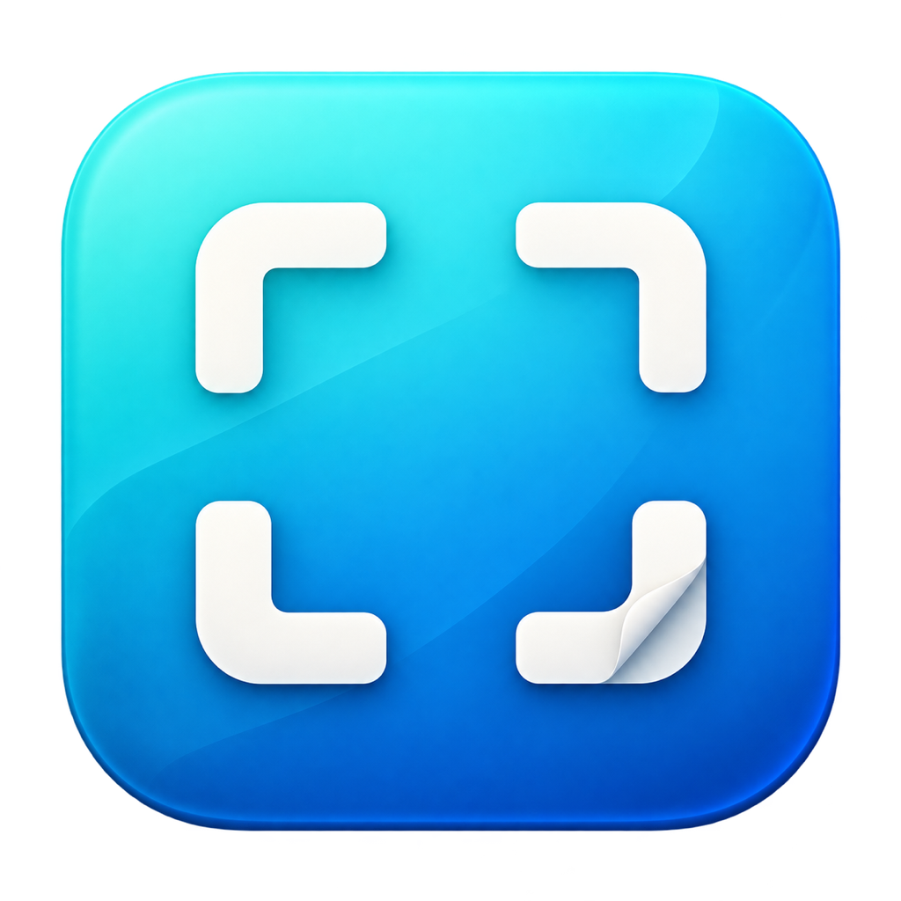

# 轻截 LightCapture

<p align="center"></p>

使用 Swift / AppKit 编写的 Mac 截图、标注与录屏工具，支持中文和英文界面。

[English](README.en.md) · [下载 v0.6.25](https://github.com/ojkwmclm/LightCapture/releases/tag/v0.6.25)

## 功能

- 紧凑置顶捕获栏：剪贴板导入、窗口／矩形区域／全屏／滚动截图、录屏、打开图片和编辑器。
- 窗口截图左键单击确认，区域截图左键拖选并松开确认；右键或 Esc 取消。
- 箭头、矩形、椭圆、画笔、高亮、文字、序号与实心遮挡；支持选中、移动、箭头端点调整、图形角点缩放、颜色／粗细、删除及撤销重做。
- PNG／JPEG／PDF 保存、图片复制、裁剪、缩放、置顶贴图和手动纵向拼接。
- Vision 本机中英文文字识别。
- 区域／窗口／全屏 MP4 录屏，可选电脑声音、麦克风、两者同时或无声。
- 有图片时才启用剪贴板导入；编辑器「复制」右侧提供「粘贴」。
- 打开编辑器时隐藏捕获栏，关闭后恢复；录屏时可从 Dock 唤回停止控制。

## 下载与运行

要求 **Apple Silicon（arm64）、macOS 15 或更新版本**，暂未提供或验证 Intel 构建。

从 [Releases](https://github.com/ojkwmclm/LightCapture/releases) 下载 `LightCapture-v0.6.25-macOS-arm64.zip`，解压并将「轻截 LightCapture.app」放入应用程序目录。

当前发行包采用临时签名，尚未经过 Developer ID 签名或 Apple 公证，macOS 可能提示无法验证开发者。截图和录屏需要在「系统设置 → 隐私与安全 → 录屏与系统录音」允许轻截；麦克风录音还需麦克风权限。更新临时签名版本后可能需要重新登记授权。

开始录屏前先选择目标和 MP4 保存路径。开始后捕获栏收起，可从 Dock 唤回并点击停止，或使用菜单栏停止录屏。

## 滚动截图

点击快速捕获栏的向下箭头，或编辑器「截图 → 滚动截图」。先将页面滚动到所需起点，再框选可滚动内容，避开固定标题栏和滚动条。自动向下滚动并去除重叠，到底后进入编辑器；也可按 Esc、点击「完成」或菜单栏「滚动截图／完成」提前结束。「取消」丢弃本次长图。

选区下沿应覆盖滚动内容区的底部；如果下沿留在视口中间，页面到底后，选区之外的尾部内容不会被补入。

需要屏幕录制及辅助功能权限。捕获期间请勿操作目标页面或移动窗口；目标可在后台保持可见；移动目标窗口或遮挡滚动落点会停止捕获；请保持整个选区可见，局部遮挡也可能出现在截图中。无法可靠对齐时保留已拼接结果并提示。最多 80 段、40000 像素高度及 6000 万总像素，先到者为准。选区不足 100 × 100 点或跨显示器时不开始。

## 快捷键

| 操作 | 快捷键 |
| --- | --- |
| 打开图片 | ⌘O |
| 剪贴板图片导入 | ⌥⌘V |
| 区域截图 | ⌥⌘2 |
| 全屏截图（主显示器） | ⌥⌘3 |
| 窗口截图 | ⌥⌘4 |
| 保存图片 | ⌘S |
| 复制标注图片 | ⇧⌘C |
| 撤销／重做 | ⌘Z／⇧⌘Z |

语言可在齿轮菜单或应用菜单中切换，系统文件选择器和权限弹窗跟随 macOS 语言。

编辑器内按住 **Control** 并滚动鼠标滚轮，可围绕指针位置缩放图片（1%–400%）；不按 Control 时仍为普通滚动。

本地 0.6.27：图片四角和四边中点提供 8 个画布调整点。向内拖裁去边缘，向外拖以白色补充新增区域，不拉伸原图；拖动时显示像素尺寸，Esc 或右键取消。松开后记为一次可撤销编辑，标注会合并到图片，撤销可恢复。单边 1–40000 像素，总计不超过 6000 万像素。

## 构建与自检

安装 Xcode Command Line Tools，在仓库目录运行：

```sh
chmod +x build.sh
./build.sh
```

脚本生成「轻截 LightCapture.app」，默认目标 `arm64-apple-macos15.0`。依赖 AppKit、Vision、ScreenCaptureKit、AVFoundation、Carbon 系统框架。

在具有桌面会话的 Mac 上运行自检，生成测试图片与 JSON 报告：

```sh
LIGHTCAPTURE_TEST_OUTPUT=/tmp/lightcapture-selftest.png "./轻截 LightCapture.app/Contents/MacOS/LightCapture" --self-test --test-exit
```

剪贴板自检使用独立命名剪贴板，不写入系统剪贴板。真实鼠标、系统权限和录屏音频需单独验收，见 [验证范围](docs/VALIDATION.md)。

## 当前边界

- 0.x 迭代版本。滚动截图支持单一显示器内向下滚动的内容区；固定标题、动画、重复内容可能无法对齐。手动拼接仍保留重叠内容。
- 导出和裁剪会合并标注，尚无可编辑工程保存；裁剪可撤销。
- 窗口截图包含目标范围内可见的遮挡内容，全屏截图当前使用主显示器。
- 尚无录屏暂停、摄像头叠加或视频剪辑。

LightCapture 借鉴 FastStone Capture 的紧凑工作流程，为独立实现的 Mac 工具，与 FastStone 无隶属关系。仓库不包含 FastStone 程序、资源或反编译产物。
